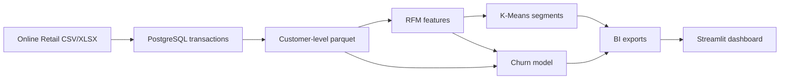

# Axlero Project 1 — Retail & Ecommerce Customer Segmentation & Churn Prediction

## Problem statement

Axlero's D2C retail partners face high acquisition costs and unpredictable
retention. This project turns retail transactions into RFM-based customer
segments, evaluates a churn-risk classifier, and exports BI-ready customer
tables for targeted retention campaigns.

## Architecture



Place the source dataset at `data/raw/online_retail.xlsx` or
`data/raw/transactions.csv` before running the initial load. Raw transaction
files are excluded from Git.

## Setup and run

From the repository root on macOS with PostgreSQL 16 installed:

```bash
python3 -m venv venv
source venv/bin/activate
python -m pip install -r requirements.txt
brew services start postgresql@16
createdb axlero_retail
make data
make features
make segments
make train
python -m src.dashboard_data
streamlit run app.py
```

`make data` loads the raw transactions into PostgreSQL and creates
`data/interim/users_raw.parquet`. If the database is already populated, skip
`createdb` and run `python src/data/make_dataset.py` to refresh the customer
summary. To connect with a non-default PostgreSQL URL, set `DATABASE_URL`
before running the data targets, for example:

```bash
export DATABASE_URL="postgresql+psycopg2://localhost:5432/axlero_retail"
```

Open `http://localhost:8501` after Streamlit starts. The notebooks provide
reproducible analysis:

- `notebooks/1.0-eda.ipynb` — initial transaction exploration
- `notebooks/2.0-rfm-clustering.ipynb` — RFM clustering and profiling
- `notebooks/3.0-churn-modeling.ipynb` — classifier comparison and diagnostics
- `notebooks/4.0-dashboard-prep.ipynb` — BI export preparation

## Current results

Run the pipeline to refresh these results for the current data and software
environment. The checked-in Week 1 summary contains 4,338 customer records.

- RFM feature retention: **100.0%** (4,338 of 4,338 customer-summary rows)
- Churn benchmark ROC-AUC: **0.783** (random stratified 20% holdout)
- Requested segment count: **4**
- Dashboard: **Streamlit** at `app.py`

| Segment | Customers | Share | Mean recency | Mean orders | Mean revenue |
|---|---:|---:|---:|---:|---:|
| Champions | 720 | 16.6% | 12.5 days | 13.7 | 8,037 |
| Promising | 877 | 20.2% | 20.6 days | 2.0 | 527 |
| At Risk (High Value) | 1,162 | 26.8% | 69.1 days | 4.1 | 1,813 |
| Hibernating | 1,579 | 36.4% | 187.7 days | 1.3 | 352 |

The churn target is currently defined as recency greater than 60 days. Recency
is excluded from model predictors to avoid direct leakage. Consequently, the
reported score distinguishes customers already beyond that recency threshold;
it is not a prospective 30-day churn estimate. See
[`reports/model_metrics.md`](./reports/model_metrics.md) for held-out metrics
and [`reports/final_report.md`](./reports/final_report.md) for the methodology
and caveats.

## Dashboard preview

> Screenshot placeholder — capture the Streamlit dashboard after launch and
> add the image here when available.

## Outputs

- `data/interim/rfm.parquet` — customer RFM features
- `data/processed/rfm_segments.parquet` — four business-labeled segments
- `data/processed/customers_scored.parquet` — churn probability and prediction
- `data/processed/bi_export.csv` — flattened dashboard export
- `data/processed/segment_summary.csv` — segment KPIs
- `data/processed/segment_actions.csv` — recommended marketing actions
- `data/processed/high_risk_customers.csv` — customers with probability > 0.70
- `models/churn_model.joblib` — selected fitted model and feature metadata
- `reports/figures/` — EDA, clustering, ROC, and notebook diagnostics

## Author

Vedant Padole
