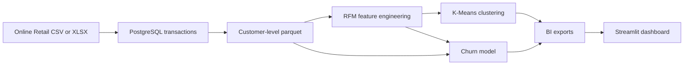

# Axlero Project 1 — Retail & Ecommerce Customer Segmentation & Churn Prediction

## Overview

An end-to-end data science project that segments retail customers using
recency, frequency, and monetary (RFM) analysis, benchmarks a churn-risk
classifier, and provides dashboard-ready data and a Streamlit dashboard.

The current churn label is a recency-based proxy: a customer is labeled churned
when their most recent purchase was more than 60 days before the snapshot.
This is not a prospective 30-day churn outcome; details are in
[`reports/model_metrics.md`](./reports/model_metrics.md).

## Problem statement

Axlero's D2C retail partners face high acquisition costs and unpredictable
retention. Without knowing which customers are valuable and which may have
lapsed, marketing budgets can be spent inefficiently. This project produces
customer segments, churn-risk scores, and actionable marketing recommendations
to support retention planning.

## Success metrics

| Metric | Target | Achieved |
|---|---:|---:|
| Customer retention through RFM preparation | ≥ 95% | 100.0% (4,338 of 4,338) |
| Churn benchmark ROC-AUC | ≥ 0.75 | 0.783 (Random Forest holdout) |
| Actionable customer segments | ≥ 4 | 4 |
| Interactive dashboard | Required | Streamlit |

The ROC-AUC is from a stratified random holdout using the recency-threshold
proxy label. It should not be interpreted as prospective 30-day churn
performance.

## Architecture



## Customer segments

| Segment | Customers | Share | Mean recency | Mean orders | Mean historical revenue | Recommendation |
|---|---:|---:|---:|---:|---:|---|
| Champions | 720 | 16.6% | 12.5 days | 13.7 | 8,037 | Reward loyalty with VIP service, early access, and referrals. |
| Promising | 877 | 20.2% | 20.6 days | 2.0 | 527 | Encourage a second purchase with relevant recommendations and a modest offer. |
| At Risk (High Value) | 1,162 | 26.8% | 69.1 days | 4.1 | 1,813 | Prioritize personalized win-back outreach and measure recovered value. |
| Hibernating | 1,579 | 36.4% | 187.7 days | 1.3 | 352 | Use low-cost reactivation and suppress repeated non-responders. |

Segment profiles and campaign actions are generated from the current dataset;
refresh the pipeline when using new client data.

## Setup and run

Run from the repository root. These instructions assume Python 3.11 and
PostgreSQL 16 are installed. Provide the input file at
`data/raw/online_retail.xlsx` or `data/raw/transactions.csv`; raw transaction
files are excluded from Git.

```bash
python3 -m venv venv
source venv/bin/activate
python -m pip install -r requirements.txt
brew services start postgresql@16
createdb axlero_retail
make data
make features
make segments
make train
python -m src.dashboard_data
streamlit run app.py
```

Open `http://localhost:8501` after Streamlit starts. If the database is
already populated, skip `createdb` and `make data`; refresh the customer
summary with:

```bash
python src/data/make_dataset.py
```

The default database URL is
`postgresql+psycopg2://localhost:5432/axlero_retail`. To override it in the
current terminal session:

```bash
export DATABASE_URL="postgresql+psycopg2://localhost:5432/axlero_retail"
```

## Notebooks

- [`notebooks/1.0-eda.ipynb`](./notebooks/1.0-eda.ipynb) — initial data exploration
- [`notebooks/2.0-rfm-clustering.ipynb`](./notebooks/2.0-rfm-clustering.ipynb) — RFM clustering and segment profiling
- [`notebooks/3.0-churn-modeling.ipynb`](./notebooks/3.0-churn-modeling.ipynb) — model comparison and diagnostics
- [`notebooks/4.0-dashboard-prep.ipynb`](./notebooks/4.0-dashboard-prep.ipynb) — dashboard and BI data preparation

## Outputs

The pipeline writes generated data and model files locally; these customer-level
artifacts are excluded from Git.

- `data/interim/rfm.parquet` — RFM features
- `data/processed/rfm_segments.parquet` — customers with four segment labels
- `data/processed/customers_scored.parquet` — churn scores and predictions
- `data/processed/bi_export.csv` — flattened dashboard export
- `data/processed/segment_summary.csv` — segment KPIs
- `data/processed/segment_actions.csv` — recommended marketing actions
- `data/processed/high_risk_customers.csv` — customers with churn probability > 0.70
- `models/churn_model.joblib` — selected model and feature metadata
- `reports/figures/` — EDA, clustering, and model diagnostic figures
- [`reports/model_metrics.md`](./reports/model_metrics.md) — evaluation results
- [`reports/final_report.md`](./reports/final_report.md) — methodology, recommendations, and limitations

## Dashboard preview

> Screenshot placeholder: capture the Streamlit dashboard after launch and
> add the image here when available.

## Author

Vedant Padole
